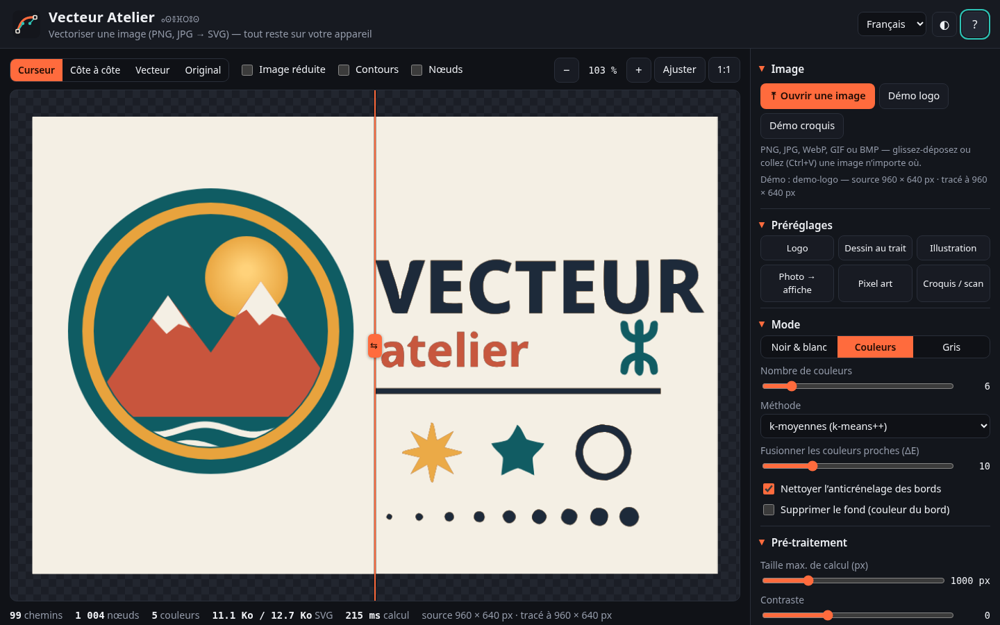
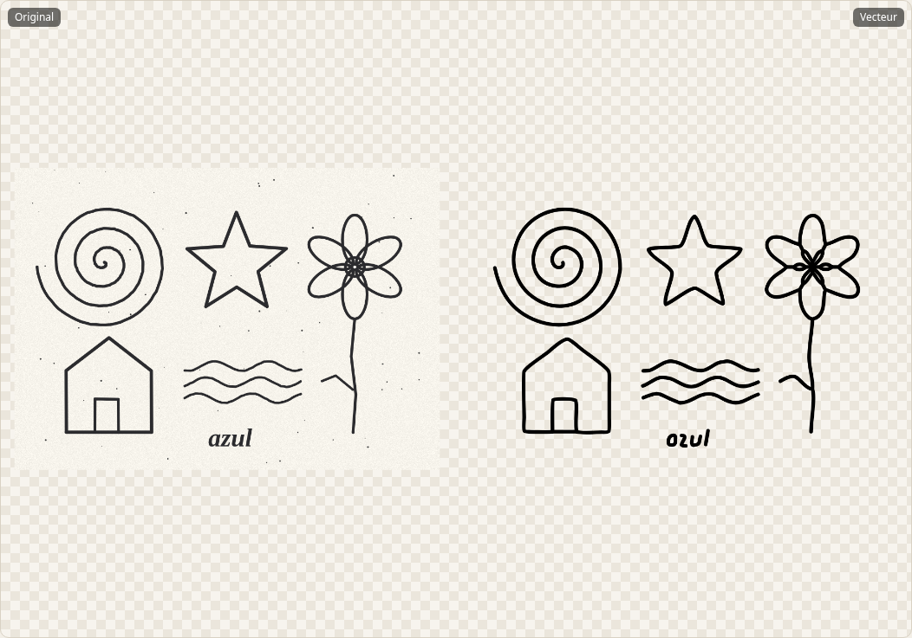
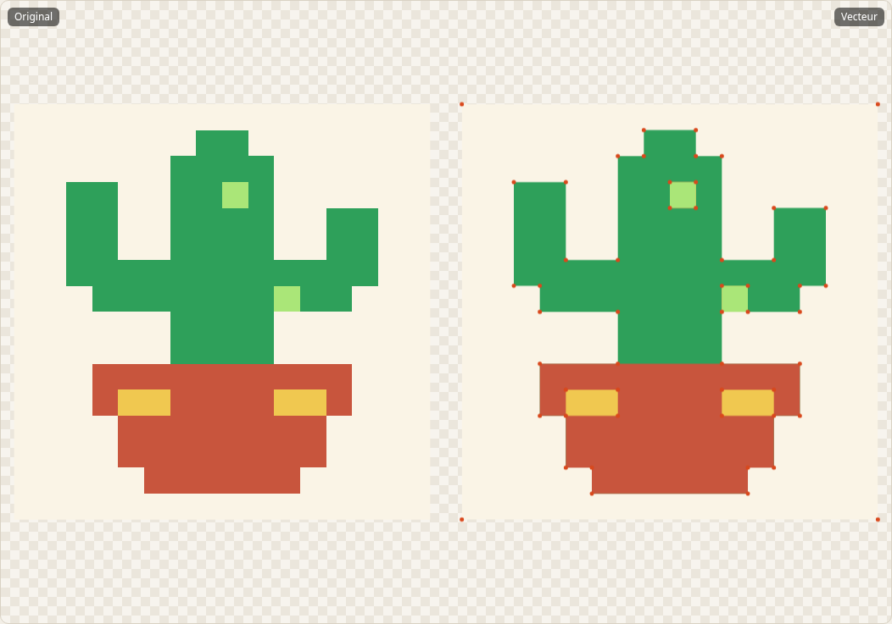
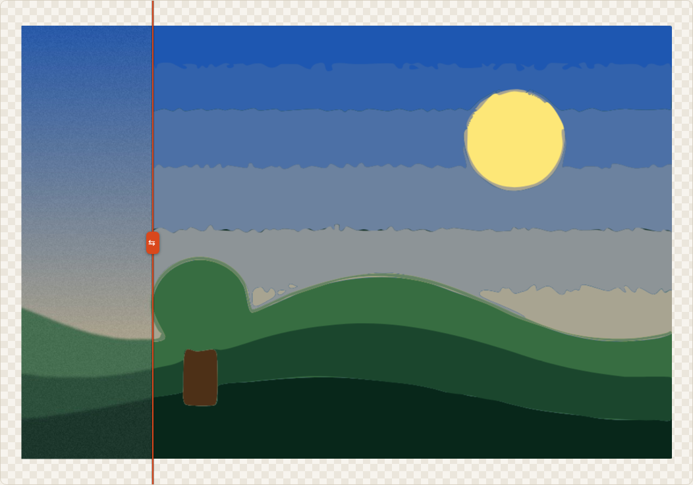
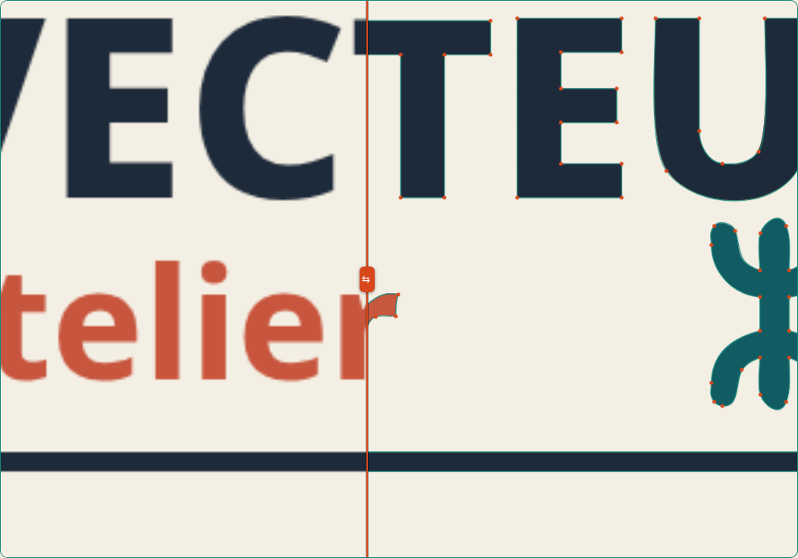
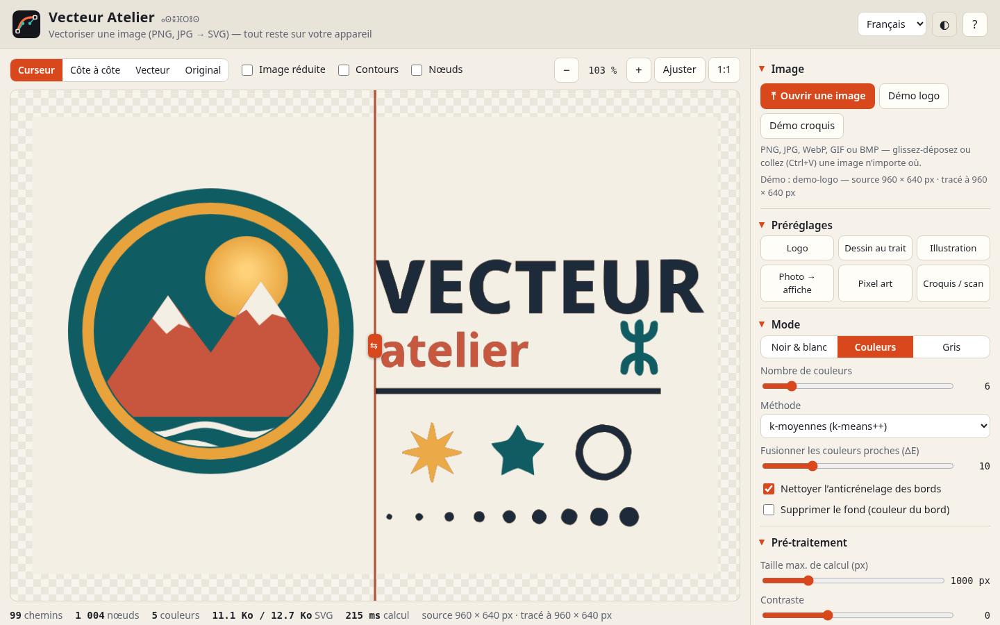
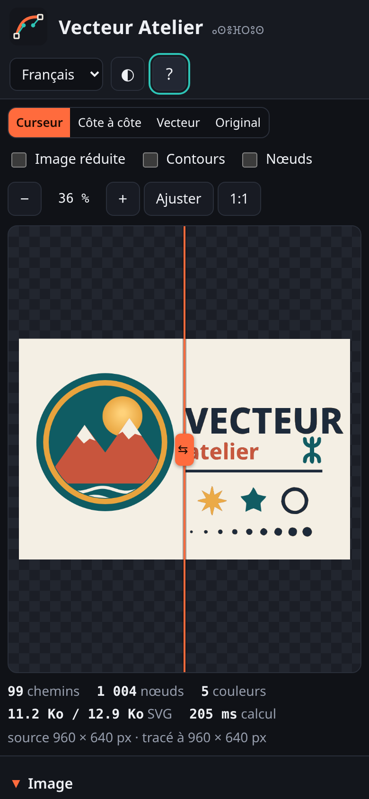

# Vecteur Atelier 

**Vectoriseur d’images gratuit et libre**, dans le navigateur : transformez un **PNG, JPG, WebP, GIF ou BMP en SVG** — logos, dessins au trait, illustrations, photos façon affiche, pixel art, croquis scannés. Noir et blanc (seuil Otsu), **couleurs** (2 à 32, k-moyennes ou coupe médiane), niveaux de gris ou **ligne centrale** ; **courbes de Bézier** lissées avec angles vifs préservés ; **SVG en calques** (un groupe par couleur, nommé par son code hexadécimal — calques directs dans Illustrator et Inkscape) ou **SVG optimisé**.

👉 **Démo : https://salimadour31-boop.github.io/vecteur-atelier/**

Interface en **français**, **anglais** et **taqbaylit** (avec affichage optionnel en **tifinagh** ⵜⵉⴼⵉⵏⴰⵖ). Aucun compte, aucune installation, aucun serveur : **vos images ne quittent jamais votre appareil**.



## Fonctionnalités

### Image
- **Ouvrir**, **glisser-déposer** n’importe où ou **coller** (Ctrl+V) : PNG (transparence conservée : les pixels transparents ne sont jamais tracés), JPG, WebP, GIF, BMP.
- Deux **images de démo dessinées par le code** (rien de protégé) : un logo en aplats (texte, anneau, étoiles, dégradé) et un croquis au crayon sur papier granuleux.

### Modes et pré-traitement
- **Noir & blanc** : seuil manuel ou **automatique (Otsu)**, inversion.
- **Couleurs** : 2 à 32 couleurs par **k-moyennes++ pondérées** (histogramme des couleurs, poids √effectif : un petit objet bien distinct garde sa couleur face à un grand dégradé) ou **coupe médiane** ; **fusion des couleurs proches** (ΔE CIELAB) ; **nettoyage de l’anticrénelage** (les pixels de bord qui mélangent leurs deux voisins rejoignent le côté le plus proche au lieu de former des liserés).
- **Niveaux de gris** : 2 à 16 niveaux.
- **Palette modifiable** : changer une couleur (sans recalcul), masquer un calque (œil), **verrouiller la palette** pour garder les mêmes couleurs quand on change les autres réglages.
- **Supprimer le fond** (couleur dominante du bord), **taille de calcul** limitée (64–4000 px), **contraste**, **lissage** (flou ≈ gaussien), **débruitage** (médian 3 × 3), **suppression des taches** de moins de N pixels.

### Tracé (algorithme original)
- **Types** : **courbes de Bézier**, **polygones** (Douglas–Peucker), **pixels exacts** (contours en escalier, idéal pour le pixel art), **ligne centrale** (traits d’épaisseur estimée automatiquement — dessins, écriture, gravure, traceur).
- **Seuil des angles** (bas = plus de coins vifs), **tolérance des courbes** (haut = moins de nœuds), **simplification** (détection des segments droits).
- **Superposition** : **empilée** (chaque couleur passe sous les suivantes : aucun jour blanc entre les formes) ou **découpée** (formes sans chevauchement, trous en `evenodd`). **Formes pleines** ou **contours seuls**.
- Calcul dans un **Web Worker** (créé à partir d’un Blob, fonctionne aussi en ouvrant `index.html` sans serveur) avec **barre de progression** et bouton **Annuler** : l’interface ne se fige pas.

### Aperçu
- **Curseur de comparaison**, **côte à côte**, vecteur seul, original seul ; comparaison avec l’**image réduite** (quantifiée).
- **Contours** et **nœuds** superposés, **zoom** (molette, pincement, boutons, 1:1) et **déplacement** (glisser, flèches).
- **Statistiques** : chemins, nœuds, couleurs, poids du SVG (optimisé / en calques), temps de calcul, tailles.

### Exports et partage
- **SVG en calques** (`<g id="hex-1D2A3A" inkscape:groupmode="layer" inkscape:label="#1D2A3A">`, un `<path>` par forme) et **SVG optimisé** (un chemin composé par couleur, commandes relatives `h/v/l/c`, décimales réglables 0–3) ; le SVG garde les dimensions de l’image d’origine.
- **Copier le SVG** dans le presse-papiers, **PNG** 1× à 8×, **palette** en JSON ou `.gpl` (GIMP, Inkscape, Krita), **réglages** en JSON (export / import), **lien partageable** (réglages dans l’adresse, `#n=6&tr=curves&cn=55…` — jamais l’image).
- **6 préréglages** : Logo, Dessin au trait, Illustration, Photo → affiche, Pixel art, Croquis / scan (ligne centrale).
- Thème clair / sombre, responsive (bureau et mobile ~390 px), clavier, libellés ARIA.

## Utilisation
1. Ouvrez la [démo](https://salimadour31-boop.github.io/vecteur-atelier/) (ou `index.html` en local).
2. **Ouvrez, déposez ou collez** votre image.
3. Choisissez le **préréglage** le plus proche, puis ajustez le **nombre de couleurs**, le **seuil des angles** et la **tolérance des courbes** en regardant l’aperçu (activez **Nœuds** pour voir la complexité).
4. **Exportez** : *SVG en calques* pour l’éditer dans Illustrator / Inkscape / Affinity, *SVG optimisé* pour le web.

Clavier (aperçu sélectionné) : `+` `−` zoom, `0` ajuster, `1` 100 %, flèches = déplacer, `S` changer d’affichage, `O` contours, `N` nœuds ; curseur de comparaison : `←` `→` (`Maj` = ×5).

## Captures
| Croquis → ligne centrale (côte à côte) | Pixel art → pixels exacts + nœuds |
|---|---|
|  |  |
| **Photo → affiche (12 couleurs)** | **Nœuds et contours (zoom ×3,2)** |
|  |  |

| Thème clair | Mobile (390 px) |
|---|---|
|  |  |

## Algorithme original
Le moteur (`js/trace.js`) a été **écrit spécialement pour ce projet**. Il **ne contient ni n’adapte de code** de potrace (GPL), imagetracerjs, autotrace ou d’un autre vectoriseur ; il met en œuvre, à partir de zéro, des méthodes classiques et publiques :
1. **Pré-traitement** : courbe de contraste, médian 3 × 3 (réseau de tri), trois flous boîte (≈ gaussien).
2. **Réduction des couleurs** : Otsu, niveaux, k-moyennes++ pondérées sur histogramme ou coupe médiane, fusion ΔE76, nettoyage de l’anticrénelage.
3. **Suppression des taches** : régions 4-connexes de moins de N px absorbées par leur voisine principale.
4. **Suivi de contours sur les arêtes des pixels** de chaque calque : contours orientés (extérieur horaire, trous antihoraires), règle « tourner à droite » aux points-selles (cohérente avec la 4-connexité), regroupement contour + trous par composante.
5. **Angles** : angle de rotation mesuré sur k échantillons du polygone des milieux d’arêtes, maxima locaux au-dessus du seuil, recalés sur le vrai coin du pixel ; léger lissage laplacien entre les angles.
6. **Douglas–Peucker** (polygones, détection des droites) et **ajustement de Bézier cubiques par moindres carrés** (tangentes imposées, reparamétrisation de Newton, découpage récursif au point d’erreur maximale).
7. **Ligne centrale** : amincissement de Zhang–Suen, nettoyage des marches, parcours du graphe du squelette, élagage des barbules, ajustement de courbes ouvertes.
8. **Écriture SVG** : coordonnées arrondies, commandes relatives, répétitions implicites.

## Confidentialité
L’image est **lue et vectorisée dans votre navigateur** (Canvas + JavaScript + Web Worker) : rien n’est envoyé sur Internet. Pas de cookies, pas de statistiques, pas de script ni de police chargés depuis un autre site. Seuls la langue, l’option tifinagh et le thème sont mémorisés localement (`localStorage`) ; le lien partageable ne contient que les réglages.

## Structure
```
index.html          interface
css/style.css       styles (sombre / clair, responsive)
js/trace.js         moteur de vectorisation original (sans DOM : Worker, page ou Node)
js/settings.js      réglages par défaut, bornes, préréglages, lien (#hash)
js/i18n.js          textes FR / EN / taqbaylit + translittération tifinagh
js/demo.js          images de démo dessinées par le code
js/app.js           interface : sources, Worker, aperçu, palette, exports
fonts/              Noto Sans Tifinagh (licence OFL, fichier inclus)
tests/              tests du moteur (Node), test d’interface (Playwright), images de test générées
```
HTML / CSS / JavaScript pur, sans dépendance ni étape de compilation.

## Tests
```
node tests/engine.test.js   # 46 tests du moteur (sans dépendance)
node tests/ui.test.js       # 102 vérifications d'interface (Playwright + Chrome/Chromium)
```
- **Moteur** : Otsu, flou, médian, k-moyennes, coupe médiane, fusion, verrouillage, transparence, taches ; contours (carré, anneau avec trou, point-selle, aires signées) ; angles, Douglas–Peucker ; carré → 4 coins exacts, disque → ≤ 8 nœuds avec IoU > 0,98 ; tolérance ↔ nombre de nœuds ; ligne centrale (anneau, barre) ; pour chaque mode × type de tracé × superposition, le SVG produit est **relu, rastérisé et comparé** à l’image réduite (> 97 % de pixels identiques, 100 % en pixels exacts) ; calques, couleurs masquées/remplacées, formatage des nombres, déterminisme ; réglages, lien et traductions.
- **Interface** (1440 × 900 et 390 × 844, plus ouverture en `file://`) : démo, 6 préréglages et 11 variantes de réglages — chaque SVG est **validé par DOMParser** puis **re-rendu par le navigateur** et comparé pixel par pixel à l’image réduite (98–100 % selon le préréglage ; IoU pour la ligne centrale) ; chargement PNG/JPG/WebP/GIF/BMP par sélecteur, collage et glisser-déposer ; progression, fluidité de l’interface pendant le calcul et annulation ; palette (couleur, masquage, verrouillage) ; tous les exports (contenu vérifié) ; lien ; langues + tifinagh ; thème ; affichages, curseur, zoom, superpositions, clavier ; noms accessibles ; aucune erreur console ; pas de débordement horizontal sur mobile.
- Contrôle indépendant : les SVG exportés, rendus par **CairoSVG**, concordent à 98,6–99,5 % avec l’image réduite.

**Limites connues** : la ligne centrale est pensée pour des traits sombres sur fond clair (le fond est retiré automatiquement) ; les photos très détaillées produisent de gros fichiers (augmentez la tolérance, les taches minimales ou baissez la taille de calcul) ; la qualité des textes en taqbaylit est une première version — les corrections sont bienvenues.

---

## English

**Vecteur Atelier** is a free, open-source **image-to-vector tracer** (bitmap → SVG) that runs entirely in your browser — nothing is uploaded.

- **Input**: open, drag-and-drop or paste PNG (alpha kept), JPG, WebP, GIF, BMP; two procedurally drawn demo images.
- **Modes**: black & white (manual / Otsu threshold, invert), colour (2–32 colours, weighted k-means++ or median cut, merge similar colours in ΔE, anti-aliasing clean-up, editable / hideable / lockable palette), grey levels, remove background.
- **Pre-processing**: working-size limit, contrast, blur, 3 × 3 median denoise, despeckle (< N px).
- **Tracing**: Bézier curves, polygons (Douglas–Peucker), exact pixels, **centreline** strokes; corner threshold, curve tolerance, simplification; stacked (gap-free) or cut-out layers; filled or outline-only. Runs in a **Web Worker** with progress bar and cancel.
- **Preview**: split slider, side by side, vector / original / reduced image, outline and node overlays, zoom and pan, stats (paths, nodes, file size, time).
- **Export**: **layered SVG** (one `<g>` per colour named by its hex code — becomes layers in Illustrator / Inkscape), **optimised SVG** (one compound path per colour, relative commands, 0–3 decimals), copy SVG, PNG 1–8×, palette JSON / GIMP `.gpl`, settings JSON (export / import), shareable link (settings only).
- **Presets**: logo, line art, illustration, photo → poster, pixel art, sketch / scan.
- French (default), English, Taqbaylit (+ optional Tifinagh); light / dark; responsive; keyboard and ARIA labels.

**Original algorithm**: the tracing engine (`js/trace.js`) was written from scratch for this project; it does **not** contain or adapt code from potrace (GPL), imagetracerjs, autotrace or any other tracer. It implements pixel-edge boundary following with a 4-connected saddle rule, corner detection on the edge-midpoint polygon, Douglas–Peucker, least-squares cubic Bézier fitting with Newton re-parameterisation, and Zhang–Suen thinning for centrelines (see the French section above for the full pipeline).

**Privacy**: images are decoded and traced locally (Canvas, JavaScript, Web Worker). No network requests, cookies or analytics; only language, Tifinagh option and theme are stored in `localStorage`.

**Usage**: open the [demo](https://salimadour31-boop.github.io/vecteur-atelier/) (or `index.html` locally, no server needed), load an image, pick a preset, tune colours / corners / tolerance while watching the preview, then export.

**Tests**: `node tests/engine.test.js` (46 engine tests, no dependencies) and `node tests/ui.test.js` (102 UI checks with Playwright at 1440 × 900 and 390 × 844, including render-back pixel comparison of every SVG, all exports, file / paste / drop loading, worker cancel, languages and accessibility).

## Licence
[MIT](LICENSE) © 2026 Amirouche Amwanes. Police Noto Sans Tifinagh : SIL Open Font License 1.1 (`fonts/OFL-NotoSansTifinagh.txt`). Images de démo et de test : créées par le code du projet.
